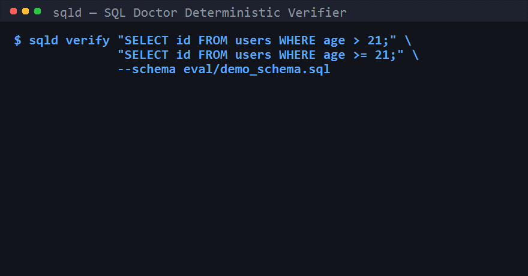
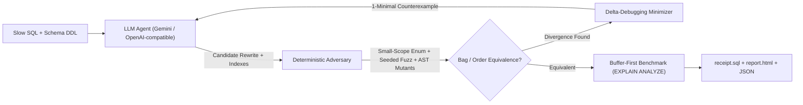

<div align="center">

# SQL Doctor (`sqld`)

**Agentic PostgreSQL Query Optimizer with Deterministic Verification & Replayable Receipts**

[](https://www.python.org/)
[](https://www.postgresql.org/)
[](tests/)
[](pyproject.toml)
[](pyproject.toml)
[](LICENSE)

*LLMs are great at proposing SQL rewrites and indexes—and terrible at knowing when a subtle `NULL`, `LEFT JOIN`, or duplicate-row bug broke semantics.*  
**SQL Doctor separates creativity from trust:** the LLM proposes, and deterministic relational machinery is the sole judge.

<br/>



</div>

---

## Architecture



### Why SQL Doctor?
1. **Zero-Trust LLM Verification:** Candidate rewrites are never accepted on LLM confidence alone. Every candidate is tested across enumerated edge-case tables (empty, singleton, `NULL`s, boundary constants $c \pm 1$) and seeded constraint-aware fuzz datasets.
2. **Minimal Counterexamples:** When a rewrite is wrong, delta-debugging strips the failing dataset down to the smallest possible separating table (e.g., 1 row) and feeds it back to the agent to self-correct.
3. **AST Mutation Adequacy (`sqlglot`):** Measures test-suite strength across 6 semantic mutation operators (`FlipComparison`, `ShiftConstant`, `SwapBoolean`, `ToggleDistinct`, `SwapAggregate`, `DropPredicate`).
4. **Buffer-First Benchmarking:** Tracks `shared_buffers` (hit + read) alongside p50 wall-time across multi-scale workloads (`EXPLAIN (ANALYZE, BUFFERS, FORMAT JSON)`).
5. **Standalone Replayable Receipts:** Every verdict emits a self-contained `receipt.sql` (replayable in plain `psql` or `sqld replay`) and an offline static HTML report.
6. **Deterministic Prompt Caching:** SHA-256 prompt-hash caching in `cache/llm/` replays repeated agent runs in milliseconds at `$0.0000` token cost.

---

## Quickstart

### 1. Environment Setup

```bash
conda activate sqldoctor
pip install -r requirements.txt
pip install -e .
```

Configure your LLM API key (for `sqld diagnose`) in `.env` based on [`.env.example`](.env.example):
```env
GEMINI_API_KEY=your_key_here
```

---

## CLI Usage & Live Examples

### 1. Deterministic Verification (`sqld verify`)
Judge a rewrite directly—no LLM or Docker required:

```bash
# Equivalent rewrite -> TESTED_EQUIVALENT (exit code 0)
sqld verify "SELECT id FROM users WHERE age > 18 AND age > 10;" "SELECT id FROM users WHERE age > 18;" --schema eval/demo_schema.sql

# Subtle boundary bug -> REJECTED with 1-row counterexample (exit code 1)
sqld verify "SELECT id FROM users WHERE age > 21;" "SELECT id FROM users WHERE age >= 21;" --schema eval/demo_schema.sql
```

Sample rejection output:
```text
Verdict: REJECTED
Seed: 20261123
Datasets evaluated: 246 (enumerated=46, fuzz=200)
[-] Candidate REJECTED. Counterexample found:
Reason: Row count mismatch
Minimal Data: {'users': [{'id': -1, 'name': '', 'age': 21}]}
Original output: []
Candidate output: [(-1,)]
```

### 2. Agentic Diagnosis (`sqld diagnose`)
Let the LLM propose optimized rewrites and covering indexes while the deterministic adversary verifies equivalence and generates auditable artifacts:

```bash
sqld diagnose examples/slow_query.sql --schema examples/schema.sql --receipt results/diag_receipt.sql --html results/diag_report.html
```

```text
============================================================
SQL DOCTOR DIAGNOSTIC REPORT
============================================================
Proposals evaluated: 1
Total LLM Cost: $0.0000
Verdict: TESTED_EQUIVALENT

[+] Recommended Rewrite:
SELECT c.id, c.name, o.amount
FROM customers c
INNER JOIN orders o ON c.id = o.customer_id
WHERE o.status = 'completed';

[*] Proposed Indexes:
  - CREATE INDEX idx_orders_status_customer_id_amount ON orders (status, customer_id, amount);
```

### 3. Replay Standalone Receipts (`sqld replay`)
Verify that any generated `.sql` receipt reproduces its recorded verdict:

```bash
sqld replay examples/receipt.sql
# [+] REPLAY VERIFIED: TESTED_EQUIVALENT reproduces recorded verdict.
```

### 4. Multi-Scale Performance Benchmarking (`sqld bench`)
Measure `shared_buffers` (hit + read) and p50 execution time across table scales:

```bash
sqld bench examples/slow_query.sql "SELECT c.id, c.name, o.amount FROM customers c INNER JOIN orders o ON c.id = o.customer_id WHERE o.status = 'completed';" --schema examples/schema.sql --scales 1000,10000 --repeats 5
```

### 5. Ephemeral PostgreSQL 17 + HypoPG Sandbox (`sqld up` / `sqld down`)
With Docker Desktop running, spin up an isolated PostgreSQL 17 container with `HypoPG` enabled:

```bash
sqld up
sqld down
```

### 6. MCP Server for Coding Agents (`sqld mcp`)
Expose `verify_rewrite`, `diagnose_query`, and `replay_receipt` over the Model Context Protocol (`stdio` or `sse`) so any coding agent can verify SQL before shipping it:

```bash
sqld mcp --transport stdio
```

Example `mcp_config.json` (Antigravity / Cursor / Claude Desktop):
```json
{
  "mcpServers": {
    "sqld": {
      "command": "sqld",
      "args": ["mcp", "--transport", "stdio"]
    }
  }
}
```

### 7. Workload Mode (`sqld workload`)
Rank a `pg_stat_statements` JSON/CSV export by total execution time, diagnose the top-$N$ queries under a global LLM cost budget, consolidate redundant indexes, and verify planner improvements with HypoPG:

```bash
sqld workload examples/pg_stat_statements.json --schema examples/schema.sql --top 3 --budget 0.50
```

### 8. Local Lab Web UI (`sqld ui`) & GitHub Pages Showcase
Launch the local Teletype + Dither FastAPI workbench for live demos (`Verify`, `Diagnose`, `Workload`, `50-Trap Eval`):

```bash
sqld ui --port 8000
```
*(Or open the static GitHub Pages showcase in [`docs/index.html`](docs/index.html).)*
Expose `verify_rewrite`, `diagnose_query`, and `replay_receipt` over the Model Context Protocol (`stdio` or `sse`) so any coding agent can verify SQL before shipping it:

```bash
sqld mcp --transport stdio
```

Example `mcp_config.json` (Antigravity / Cursor / Claude Desktop):
```json
{
  "mcpServers": {
    "sqld": {
      "command": "sqld",
      "args": ["mcp", "--transport", "stdio"]
    }
  }
}
```

---

## Evaluation Suites (`sqld eval`)

SQL Doctor ships with three benchmark suites under [`eval/suites/`](eval/suites/):
- **Trap Suite v2 (50 cases):** Known-wrong SQL rewrites spanning `NOT IN` + `NULL` traps, `UNION` vs `UNION ALL`, outer-to-inner join collapses, `LIMIT` without deterministic ties, window frame errors, and multiset duplication bugs.
- **Good-Rewrite Suite v2 (30 cases):** Known-equivalent rewrites (predicate pushdown, CTE inlining, algebraic identities, join commutativity).
- **Performance Suite (30 cases):** TPC-H-derived analytical and OLTP queries benchmarked across multi-scale tables.

```bash
# Run all suites + baselines + ablations (Release gate: 0 false accepts on Trap Suite v2)
sqld eval --suite all --baselines --ablations --out-dir eval/results
```

| Method / Suite | Cases | False Accepts | Accuracy |
| :--- | :---: | :---: | :---: |
| **SQL Doctor (Full)** — Trap Suite v2 | 50 | **0** | **100.0%** |
| **LLM-as-judge (Gemini)** — Trap Suite v2 | 50 | 3 | 94.0% |
| **SQL Doctor (No Enum Ablation)** — Trap Suite v2 | 50 | 3 | 94.0% |
| **SQL Doctor (No Fuzz Ablation)** — Trap Suite v2 | 50 | 13 | 74.0% |
| **SQL Doctor (Full)** — Good Suite v2 | 30 | 0 *(0 False Rejects)* | **100.0%** |
| **Performance Suite** (TPC-H Derived) | 30 | — | Logged to `eval/results/perf_results.json` |

---

## Quality & Test Suite

```bash
pytest -v                       # 129 unit & integration tests
ruff check src eval tests       # Linter
ruff format --check src eval tests
mypy src eval tests             # Strict type checking across 76 source files
```

---

## Project Layout

```text
sqld/
├── docker/                 # PostgreSQL 17 + HypoPG sandbox image
├── docs/                   # Architectural decision records (ADR)
├── eval/
│   ├── suites/             # Trap Suite v2 (50), Good Suite v2 (30), Perf Suite (30)
│   └── results/            # Persisted JSON & Markdown evaluation reports
├── examples/               # Sample schema, slow query, receipt.sql, report.html
├── src/sqldoctor/
│   ├── adversary/          # Constant pool, small-scope enumerator, delta minimizer
│   ├── agent/              # LLM adapter, prompt-hash cache, plan normalizer, loop
│   ├── bench/              # Multi-scale interleaved buffer & latency harness
│   ├── compare/            # Multiset bag (EXCEPT ALL), order, NULL, float comparator
│   ├── datagen/            # Topological constraint-aware seeded data generator
│   ├── eval/               # Evaluation orchestrator & baseline/ablation runner
│   ├── mcp/                # FastMCP server & Pydantic-validated tool handlers
│   ├── mutate/             # sqlglot AST mutation engine & adequacy scoring
│   ├── receipt/            # Standalone receipt.sql writer & replay verifier
│   ├── report/             # Zero-dependency Jinja2 static HTML report generator
│   ├── sandbox/            # Docker lifecycle, psycopg3 pool, template DB cloning
│   ├── schema/             # pg_catalog & DDL schema parser (strict Pydantic)
│   ├── sql/                # sqlglot Postgres AST parser & round-tripping
│   ├── ui/                 # FastAPI local workbench & Teletype + Dither UI
│   ├── verifier/           # AdversaryVerifier & fixed-random baseline verifier
│   └── workload/           # pg_stat_statements parser, index consolidation, HypoPG
└── tests/                  # 129 automated unit & integration tests
```

---

## License

Licensed under the [Apache License 2.0](LICENSE).
